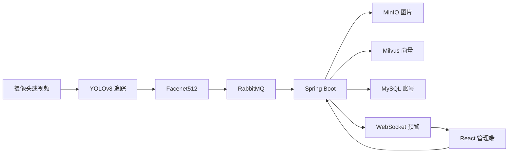

# Face Recognition System

监控视频里的人脸检测、跨镜头归并、以脸搜轨迹，以及嫌疑人实时预警。

Python 负责看视频，Java 负责存储和检索，React 负责给管理员使用。一条抓拍离开摄像头之后，会变成一张人脸图和一个 512 维向量，再进入人物库。被标成嫌疑人的人再次出现时，Dashboard 会马上收到预警。

[](LICENSE)
[](backend/springboot/pom.xml)
[](backend/springboot/pom.xml)
[](backend/requirements.txt)
[](frontend/package.json)

当前版本见 [v5.0.0](https://github.com/JK666-bug/face-recognition-system2/releases/tag/v5.0.0) 和 [CHANGELOG](CHANGELOG.md)。数据怎么流、三套 ID 和阈值为什么分开，写在 [技术说明](docs/PROJECT_TECHNICAL_SPEC_ZH.txt)。

## 它做什么

管理端登录后是一块 Dashboard，页签和代码里的名字一致：

| 页签 | 谁能看 | 做什么 |
| --- | --- | --- |
| Analytics Overview | 所有管理员 | 今日抓拍、人脸和人物数量，Milvus / MinIO / RabbitMQ 状态，嫌疑人实时预警 |
| Trajectory Search | 所有管理员 | 上传一张脸，按相似度和时间在抓拍库里找轨迹，并回放对应视频 |
| People Library | 超级管理员 | 人物底库。上传照片建档、标记嫌疑人、合并重复人物、换代表脸、删除 |
| Dataset | 超级管理员 | 浏览和删除抓拍记录 |
| Access Control | 超级管理员 | 注册管理员、提升为超级管理员、删除普通管理员 |
| Settings | 超级管理员 | 调整抓拍置信度和三套比对阈值 |

默认账号 `admin` / `admin` 是超级管理员。在 Access Control 里新建的用户角色是 `ADMIN`，只能看到总览和轨迹检索。

## 架构



抓拍进程读摄像头或视频文件，用 YOLOv8 的 `track` 在镜头里跟着每一张脸。需要入库时用 DeepFace 的 Facenet512 抽出 512 维向量，经 RabbitMQ 的 `face_recognition_queue` 发给 Spring Boot。Java 把人脸图写入 MinIO，把向量写入 Milvus，用 MySQL 只保存登录账号。浏览器通过 REST 和 JWT 访问 `8080`，预警走 `/ws-alerts`。

人物库上传和以脸搜图不走消息队列。Spring Boot 调用 `backend/algorithms/extract_cli.py`：先检出最大的一张脸，再提向量。

### 设计上分开的四件事

- **三个 ID。** `track_id` 只在一次视频里用来跨帧跟踪，不会发给后端。`face_id` 是一次抓拍。`people_id` 是跨镜头的同一个人，多条抓拍可以共用。
- **四类抓拍时机。** 脸第一次进入画面推 `ENTER`；更正、置信度明显更高时推 `QUALITY`；同一张脸超过 60 秒再推 `STAYING`；离开画面推 `LEAVE`。
- **三套阈值，互不替代。** `searchThreshold` 用于以脸搜图，`peopleMatchThreshold` 用于把抓拍归到已有人物，`alertMatchThreshold` 用于嫌疑人实时预警。轨迹页上的“嫌疑人”标记看的是人物库里的标记，和 WebSocket 实时预警不是同一个判断。
- **先有图，再有向量。** MinIO 写入失败时不再写 Milvus，避免库里留下没有图片的向量。

## 技术栈

| 层 | 选择 |
| --- | --- |
| 检测和追踪 | Ultralytics YOLOv8，权重 `yolov8n-face.pt` |
| 特征 | DeepFace Facenet512，512 维，余弦相似度 |
| 抓拍进程 | Python 3.10+，OpenCV，经 Pika 发 RabbitMQ |
| 业务 API | Java 17，Spring Boot 3.2，Spring Security，JWT |
| 向量 | Milvus 2.3，集合 `face_embeddings` / `people_embeddings` / `alert_embeddings` |
| 图片和回放 | MinIO，桶 `faces` / `people` / `videos` / `places` |
| 账号 | MySQL 8，表 `sys_user` |
| 管理端 | React 18，Vite 5，React Router |

## 环境

- Docker Desktop
- JDK 17+
- Node.js 18+
- Python 3.10+
- 仓库里已经带了 `yolov8n-face.pt` 和 Facenet / Facenet512 权重，放在 `backend/algorithms/models/`。没有专用人脸权重时，检测器会退回通用的 `yolov8n.pt`，那是物体检测模型，脸会检不准

权重文件较大，是为了换一台机器时不必再下载模型。

## 启动

四步，从底层到页面。下面的命令以 macOS / Linux 为例，在仓库根目录执行。Windows 的差异写在每一步后面。

### 1. 中间件

```bash
docker compose up -d
```

旧版 Docker 用 `docker-compose up -d`。第一次会拉镜像。

| 服务 | 地址 | 本地演示账号 |
| --- | --- | --- |
| RabbitMQ 管理台 | http://localhost:15672 | `guest` / `guest` |
| RabbitMQ 程序端口 | `localhost:5888` | 同上。映射成 5888 是为了避开 Windows 保留端口 |
| MinIO 控制台 | http://localhost:30001 | `minioadmin` / `minioadmin` |
| MinIO API | http://localhost:30000 | 同上 |
| Milvus | `localhost:19530` | 无账号 |
| Attu | http://localhost:5000 | Milvus 的查看界面 |
| MySQL | `localhost:3306` | 库 `face_recognition`，用户 `face` / `face`，root 密码 `root` |

这些口令只适合本机演示。对外部署前要换成自己的密码，并更换 `application.yml` 里的 JWT secret。

Milvus 的集合由应用启动时创建。旧库如果字段对不上，需要在 Milvus 里处理旧集合，应用不会自动迁移历史向量。

### 2. 管理端

```bash
cd frontend
npm install
npm run dev
```

打开 http://localhost:5173 。前端把 API 写死在 `http://localhost:8080`，所以要等下一步的后端起来再登录。

### 3. Spring Boot

用 IDE 打开**仓库根目录**，运行：

`backend/springboot/src/main/java/com/face/recognition/FaceRecognitionApplication.java`

Java 和 Python 都读仓库根目录的 `config/settings.json`。虚拟环境和 `extract_cli.py` 也从这里找。IDE 如果把工作目录设在 `backend/springboot`，启动时会向上找到仓库根目录。`mvn spring-boot:run` 同样把进程工作目录设到仓库根目录。

看到 `Started FaceRecognitionApplication` 后，后端在 `8080`。库里没有 `admin` 时会自动创建 `admin` / `admin`。

```bash
mvn -f backend/springboot/pom.xml spring-boot:run
```

### 4. 抓拍

```bash
python3 -m venv .venv
source .venv/bin/activate
pip install -r backend/requirements.txt

python backend/algorithms/demo.py --source 0 --location "Entrance"
```

处理一段视频：

```bash
python backend/algorithms/demo.py --source path/to/video.mp4 --location "Main Gate"
```

Windows 激活虚拟环境用 `.\.venv\Scripts\Activate.ps1`。终端里出现 `YOLOv8 实时面部追踪与自动去重系统` 后，总览页会开始收到抓拍。

常用参数：

| 参数 | 作用 | 默认 |
| --- | --- | --- |
| `--source` | 摄像头编号，或视频路径 | `0` |
| `--location` | 写入抓拍元数据的地点 | `Unknown` |
| `--conf` | 检测置信度 | `config/settings.json` 的 `captureConfidence`，文件缺失时 `0.65` |
| `--model` | 检测权重 | `backend/algorithms/models/yolov8n-face.pt` |
| `--no-display` | 不弹预览窗口 | 关闭 |
| `--no-save-faces` | 不把人脸小图写到本地 `output/` | 关闭。关掉本地保存时仍会推送后端 |

有 NVIDIA GPU 时可以安装 CUDA 版 PyTorch，检测器会使用可见的 CUDA 设备。CPU 可以直接跑。

## 配置

仓库根目录的 [`config/settings.json`](config/settings.json)：

| 字段 | 现在的值 | 用在哪 |
| --- | --- | --- |
| `captureConfidence` | `0.7` | Python 检测置信度 |
| `searchThreshold` | `0.6` | 以脸搜图 |
| `peopleMatchThreshold` | `0.6` | 抓拍归并到已有人物 |
| `alertMatchThreshold` | `0.6` | 嫌疑人实时预警 |

连接信息在 [`backend/springboot/src/main/resources/application.yml`](backend/springboot/src/main/resources/application.yml)。Java 在找不到 `config/settings.json` 时，默认阈值比这份文件更严：检索 `0.70`，人物归并 `0.80`，预警 `0.85`。

## 目录

```text
face-recognition-system2/
├── backend/
│   ├── algorithms/                 # 检测、追踪、特征、推送
│   │   ├── demo.py                 # 摄像头 / 视频入口
│   │   ├── face_detection.py
│   │   ├── feature_extraction.py   # DEEPFACE_HOME 指向 models/
│   │   ├── extract_cli.py          # 供 Java 上传和搜图调用
│   │   ├── backend_pusher.py       # RabbitMQ 生产者
│   │   └── models/                 # yolov8n-face 和 DeepFace 权重
│   ├── requirements.txt
│   └── springboot/                 # REST、入库、检索、预警、账号
├── frontend/                       # React + Vite
├── config/settings.json
├── docker-compose.yml              # MySQL、Milvus、MinIO、RabbitMQ、Attu
├── docs/PROJECT_TECHNICAL_SPEC_ZH.txt
├── CHANGELOG.md
└── LICENSE
```

抓拍模块的命令说明在 [backend/algorithms/README.md](backend/algorithms/README.md)。

## 测试

```bash
cd backend/springboot
mvn test
```

现有测试覆盖 JWT、阈值回填和 MinIO 元数据解析，不连接 Milvus、MinIO 或 MySQL。

## 排错

- **3306 被占用。** 本机如果另有 MySQL 服务，先停掉，让容器里的 MySQL 占用 3306。
- **8080 被占用。** 停掉上一次的 Spring Boot 再启动。
- **没有实时预警。** 人物要先标成嫌疑人；相似度要过 `alertMatchThreshold`；RabbitMQ 要通；Dashboard 要开着，WebSocket 状态应是 connected。轨迹上的嫌疑人标记和这条实时预警不是同一个条件。
- **上传或搜图提不出特征。** 虚拟环境要建在仓库根目录的 `.venv`。Windows 用 `Scripts/python.exe`，macOS / Linux 用 `bin/python`，后端会按这个顺序找。
- **Python 报没有 `pika`。** 重新执行 `pip install -r backend/requirements.txt`。

## 许可证

[MIT](LICENSE)
