# Face Recognition System

Detect faces from a camera, a video file, or an RTSP/HTTP stream, group the same person across shots, search a trajectory by photo, and raise a live alert when a marked suspect appears.

Python watches the video. Java stores and searches. React is the admin console. Each capture becomes one face image plus a 512-dimensional vector, then joins a person record. A later match against the suspect set is pushed to the dashboard over WebSocket.

[](LICENSE)
[](backend/springboot/pom.xml)
[](backend/springboot/pom.xml)
[](backend/requirements.txt)
[](frontend/package.json)

Current release: [v5.1.0](https://github.com/JK666-bug/face-recognition-system2/releases/tag/v5.1.0). History is in [CHANGELOG](CHANGELOG.md). How IDs, thresholds, and storage fit together is in the [technical note](docs/TECHNICAL_SPEC.md).

## Interface

The console is a single dashboard. `admin` / `admin` is created on first boot as `SUPER_ADMIN`. Accounts created under Access Control are `ADMIN`. They can open Analytics Overview, Detection Task, and Trajectory Search.

| Tab | Who | What it does |
| --- | --- | --- |
| Analytics Overview | Every admin | Captures, face and person counts, Milvus / MinIO / RabbitMQ health, live suspect alerts |
| Detection Task | Every admin | Start a webcam or an RTSP/HTTP URL. Several tasks can run at the same time |
| Trajectory Search | Every admin | Upload a face, filter by similarity and time, play the linked video |
| People Library | Super admin | Enroll a person, mark a suspect, merge duplicates, replace the photo, delete |
| Dataset | Super admin | Browse and delete capture records |
| Access Control | Super admin | Register admins, promote a super admin, delete a normal admin |
| Settings | Super admin | Capture confidence and the three match thresholds |

<table>
  <tr>
    <td width="50%">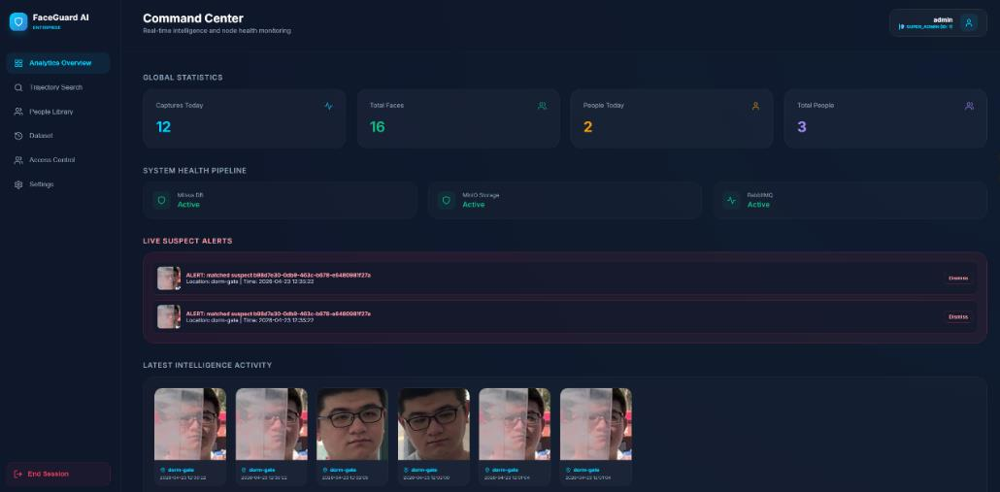</td>
    <td width="50%">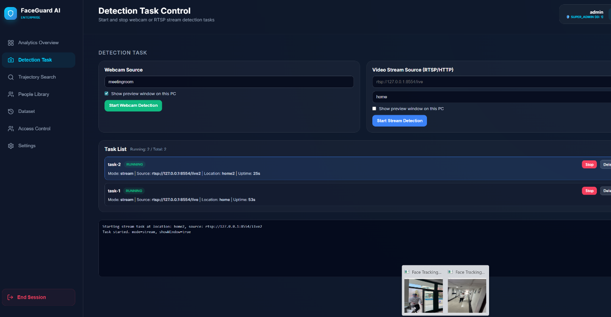</td>
  </tr>
  <tr>
    <td width="50%">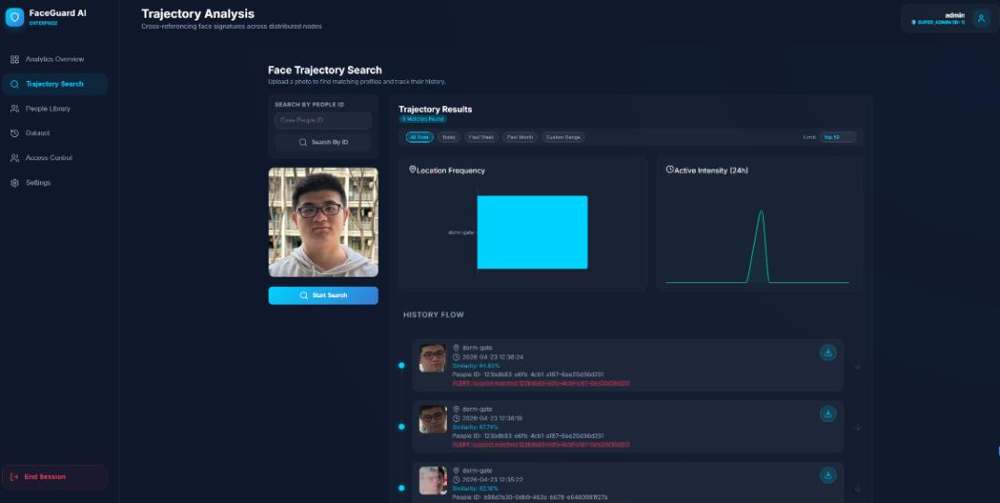</td>
    <td width="50%">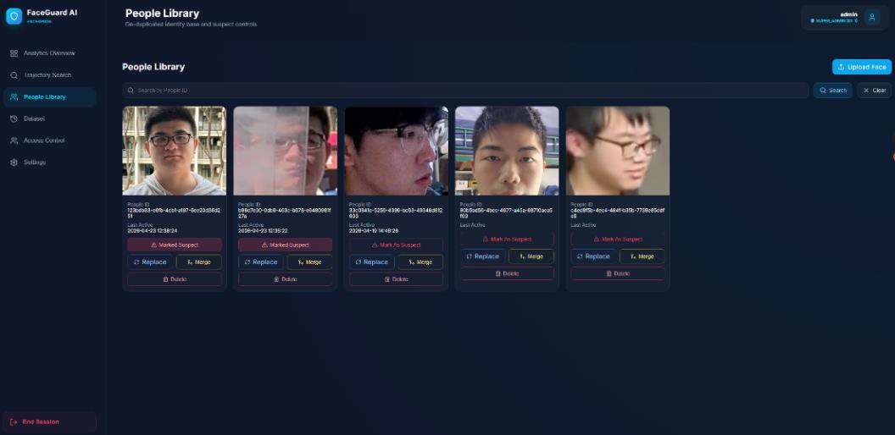</td>
  </tr>
  <tr>
    <td width="50%">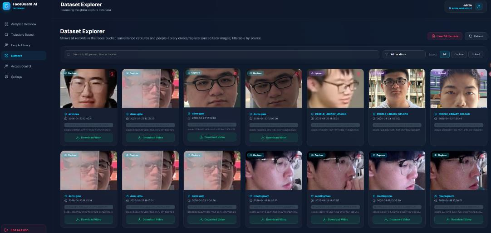</td>
    <td width="50%">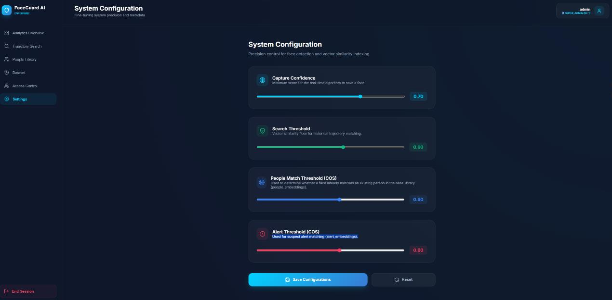</td>
  </tr>
  <tr>
    <td width="50%">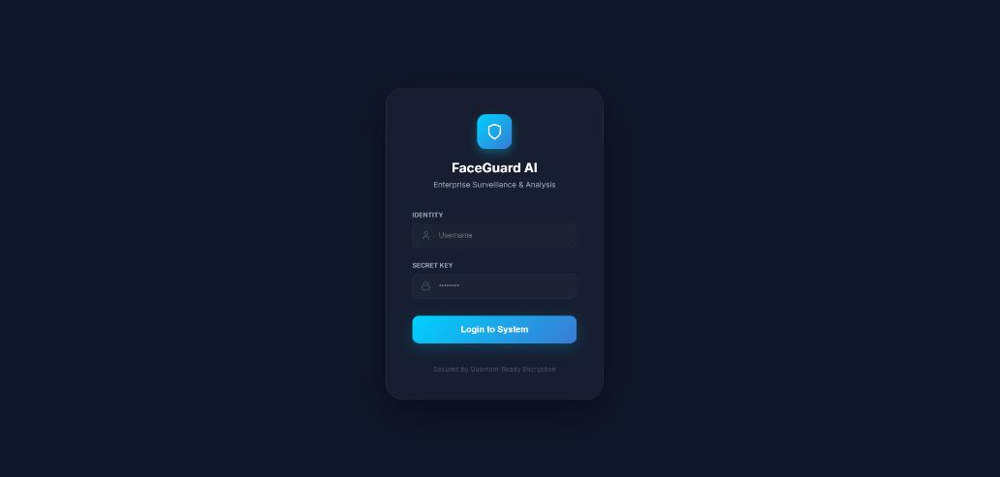</td>
    <td width="50%">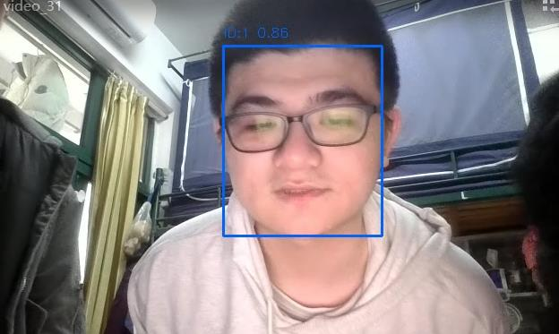</td>
  </tr>
</table>

## Architecture

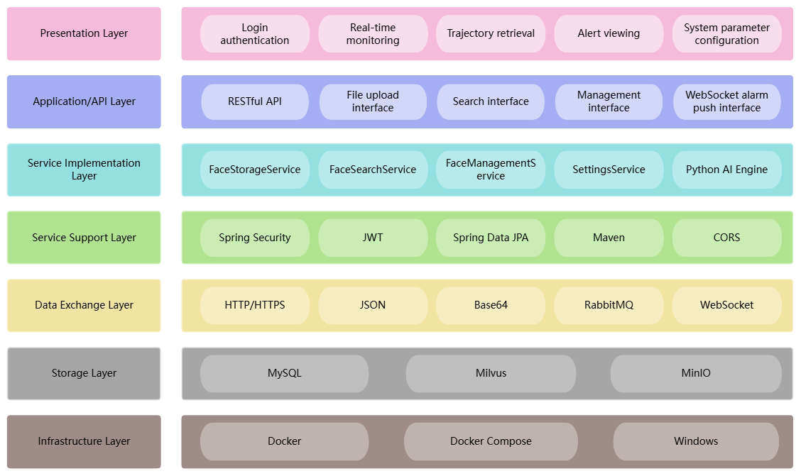

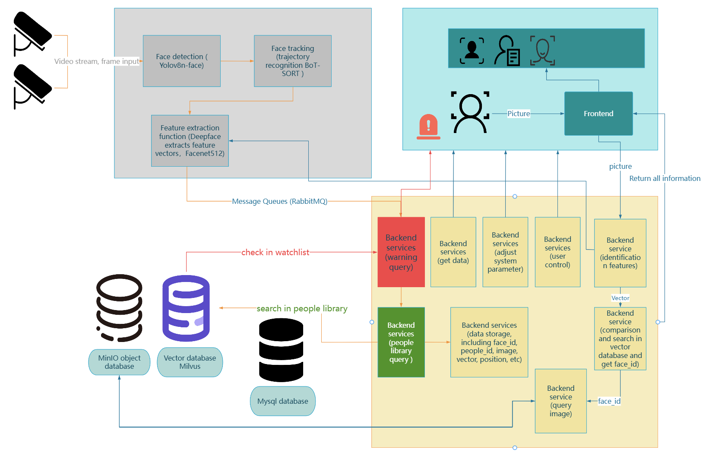

A capture process reads a camera, a video file, or an RTSP/HTTP URL. YOLOv8 `track` follows each face. When a face should be stored, DeepFace Facenet512 produces a 512-d vector and Pika publishes it to the RabbitMQ queue `face_recognition_queue`. Spring Boot writes the image to MinIO and the vector to Milvus. MySQL stores login accounts only. The browser calls REST on port `8080` with a Bearer JWT. Alerts use `/ws-alerts`.

Uploads and photo search do not use the queue. Spring Boot runs `backend/algorithms/extract_cli.py`, which crops the largest face and returns an embedding.

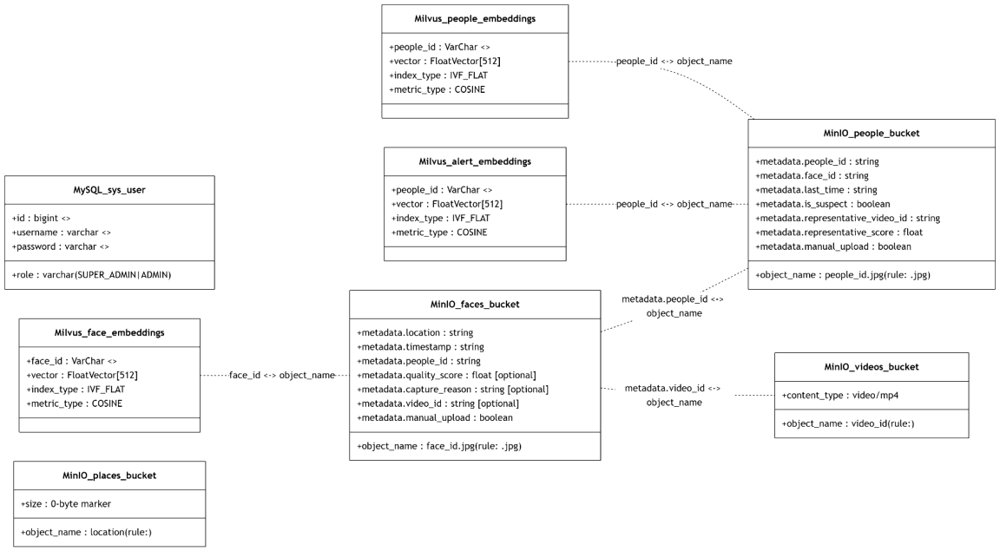

### Four boundaries in the design

- **Three IDs.** `track_id` exists only inside one video so the tracker can follow a face across frames. It is never sent to Java. `face_id` is one capture. `people_id` is one person across captures.
- **Four capture reasons.** `ENTER` on the first frame, `QUALITY` when a more frontal or more confident view appears, `STAYING` after 60 seconds, `LEAVE` when the track disappears.
- **Three thresholds.** `searchThreshold` is for photo search. `peopleMatchThreshold` assigns a capture to an existing person. `alertMatchThreshold` fires a live suspect alert. A suspect badge on a trajectory reads the person-library flag. It is a different check from the WebSocket alert.
- **Image first, then vector.** If the MinIO write fails, the vector is not inserted.


## Stack

| Layer | Choice |
| --- | --- |
| Detection and tracking | Ultralytics YOLOv8, weight file `yolov8n-face.pt` |
| Embedding | DeepFace Facenet512, 512 dimensions, cosine similarity |
| Capture process | Python 3.10+, OpenCV, Pika to RabbitMQ |
| API | Java 17, Spring Boot 3.2, Spring Security, JWT |
| Vectors | Milvus 2.3 collections `face_embeddings`, `people_embeddings`, `alert_embeddings` |
| Images and playback | MinIO buckets `faces`, `people`, `videos`, `places` |
| Accounts | MySQL 8 table `sys_user` |
| Console | React 18, Vite 5, React Router |

## Requirements

- Docker Desktop
- JDK 17+
- Node.js 18+
- Python 3.10+

`yolov8n-face.pt` and the Facenet / Facenet512 weights are already in `backend/algorithms/models/`. If the face weight is missing, the detector falls back to generic `yolov8n.pt`, which is an object detector and will miss faces. The weight files are large so a new machine does not have to download them on first run.

## Run

Run these from the repository root. The shell examples are macOS and Linux. The Windows difference is called out in the capture step.

### 1. Middleware

```bash
docker compose up -d
```

Older Docker uses `docker-compose up -d`. The first run pulls images.

| Service | Address | Local demo account |
| --- | --- | --- |
| RabbitMQ console | http://localhost:15672 | `guest` / `guest` |
| RabbitMQ client port | `localhost:5888` | Same account. Host port 5888 avoids a reserved Windows range |
| MinIO console | http://localhost:30001 | `minioadmin` / `minioadmin` |
| MinIO API | http://localhost:30000 | Same account |
| Milvus | `localhost:19530` | No account |
| Attu | http://localhost:5000 | Milvus browser |
| MySQL | `localhost:3306` | Database `face_recognition`, user `face` / `face`, root password `root` |

These passwords are for a local demo. Change them, and the JWT secret in `application.yml`, before any shared deployment.

Milvus collections are created on startup. An older collection with a different schema has to be rebuilt by hand. The app does not migrate old vectors.

### 2. Console

```bash
cd frontend
npm install
npm run dev
```

Open http://localhost:5173. The UI calls `http://localhost:8080`, so log in after the API is up.

### 3. Spring Boot

Open the repository root in an IDE and run:

`backend/springboot/src/main/java/com/face/recognition/FaceRecognitionApplication.java`

Java and Python both read `config/settings.json` at the repository root. The virtualenv and `extract_cli.py` are resolved from that same root, including when an IDE starts with its working directory in `backend/springboot`. `mvn spring-boot:run` sets the process working directory to the repository root.

When the log shows `Started FaceRecognitionApplication`, the API is on port `8080`. If no `admin` user exists, one is created with password `admin`.

```bash
mvn -f backend/springboot/pom.xml spring-boot:run
```

### 4. Capture

```bash
python3 -m venv .venv
source .venv/bin/activate
pip install -r backend/requirements.txt

python backend/algorithms/demo.py --source 0 --location "Entrance"
```

A video file:

```bash
python backend/algorithms/demo.py --source path/to/video.mp4 --location "Main Gate"
```

An RTSP or HTTP URL uses the same flag. The Detection Task page does this for you: it starts one `demo.py` process per webcam or stream, and more than one can run together.

```bash
python backend/algorithms/demo.py --source "rtsp://127.0.0.1:8554/live" --location "Main Gate" --no-display
```

This repository does not publish the stream. An outside system does. In the project demo, FFmpeg pushed a local video into MediaMTX, and the console then opened the RTSP URL MediaMTX exposed. That is the stand-in for an enterprise system handing over a live stream.

On Windows, activate with `.\.venv\Scripts\Activate.ps1`. After the banner `YOLOv8 live face tracking` appears, captures show up on the overview page. Stopping a task from the page stops that Python process. Restarting Spring Boot clears the task list. The captures already stored in MinIO and Milvus stay.

| Flag | Meaning | Default |
| --- | --- | --- |
| `--source` | Camera index, video path, or RTSP/HTTP URL | `0` |
| `--location` | Location stored on the capture | `Unknown` |
| `--conf` | Detection confidence | `captureConfidence` in `config/settings.json`, or `0.65` if that file is missing |
| `--model` | Detector weights | `backend/algorithms/models/yolov8n-face.pt` |
| `--no-display` | Hide the preview window | off |
| `--no-save-faces` | Skip writing face crops under `output/` | off. The backend still receives the capture |

With an NVIDIA GPU, install a CUDA build of PyTorch and the detector uses the visible CUDA device. CPU is enough to run.

## Configuration

[`config/settings.json`](config/settings.json) at the repository root:

| Field | Value in the repo | Used for |
| --- | --- | --- |
| `captureConfidence` | `0.7` | Python detection confidence |
| `searchThreshold` | `0.6` | Photo search |
| `peopleMatchThreshold` | `0.6` | Assign a capture to an existing person |
| `alertMatchThreshold` | `0.6` | Live suspect alert |

Connection settings are in [`backend/springboot/src/main/resources/application.yml`](backend/springboot/src/main/resources/application.yml). If `config/settings.json` is missing, Java falls back to stricter defaults: search `0.70`, people match `0.80`, alert `0.85`.

## Layout

```text
face-recognition-system2/
├── backend/
│   ├── algorithms/                 # detect, track, embed, publish
│   │   ├── demo.py                 # camera, file, or stream URL
│   │   ├── face_detection.py
│   │   ├── feature_extraction.py   # DEEPFACE_HOME points at models/
│   │   ├── extract_cli.py          # called by Java for upload and search
│   │   ├── backend_pusher.py       # RabbitMQ producer
│   │   └── models/                 # yolov8n-face and DeepFace weights
│   ├── requirements.txt
│   └── springboot/                 # REST, detection tasks, storage, search, alerts
├── frontend/                       # React + Vite
├── config/settings.json
├── docker-compose.yml              # MySQL, Milvus, MinIO, RabbitMQ, Attu
├── docs/TECHNICAL_SPEC.md
├── docs/images/
├── CHANGELOG.md
└── LICENSE
```

Capture flags are also listed in [backend/algorithms/README.md](backend/algorithms/README.md).

## Tests

```bash
cd backend/springboot
mvn test
```

The tests cover JWT, threshold fallback, and MinIO metadata flags. They do not connect to Milvus, MinIO, or MySQL.

## Troubleshooting

- **Port 3306 is taken.** Stop any MySQL already installed on the machine so the container can bind 3306.
- **Port 8080 is taken.** Stop the previous Spring Boot process.
- **No live alert.** The person must be marked as a suspect, the score must pass `alertMatchThreshold`, RabbitMQ must be up, and the dashboard must stay open with the WebSocket connected. A suspect badge on a trajectory is a different check.
- **Upload or search cannot embed a face.** Create `.venv` at the repository root. Windows is resolved as `Scripts/python.exe`. macOS and Linux are resolved as `bin/python`.
- **Python reports `No module named pika`.** Run `pip install -r backend/requirements.txt` again.

## License

[MIT](LICENSE)
