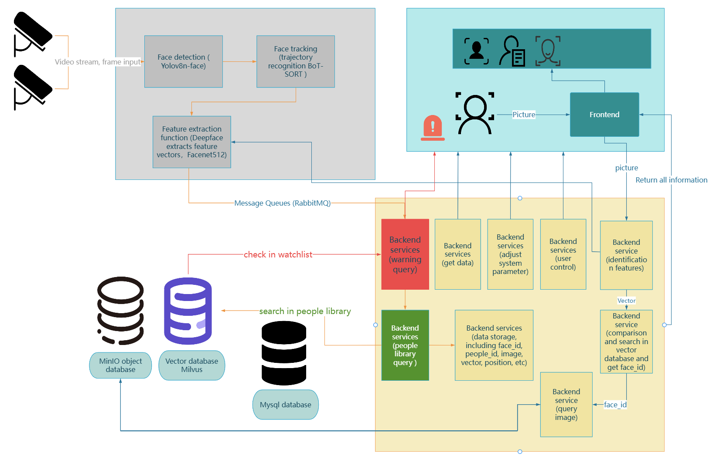
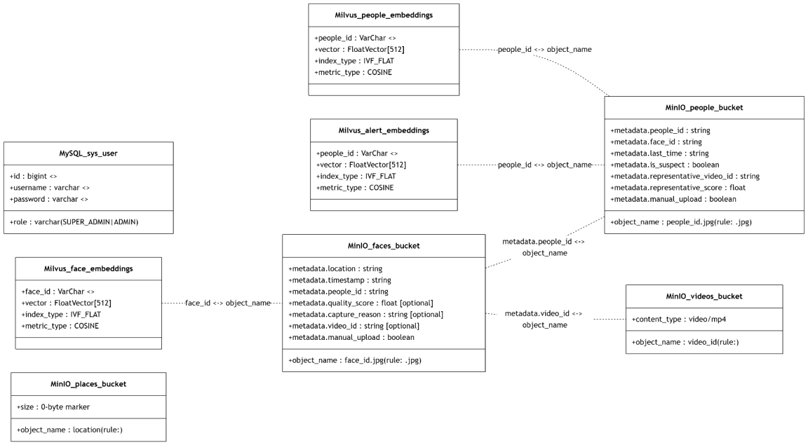

# Technical note

This note describes what the current code does: how the processes talk, how a capture is stored, and how the three IDs and three thresholds stay separate. Commands for running the system are in the repository [README](../README.md).

## What the system does

A camera, a video file, or an RTSP/HTTP URL is tracked with YOLOv8 (`track`, `persist=True`). A face chosen for storage is cropped and embedded with DeepFace Facenet512 (512 dimensions). RabbitMQ carries the image, the vector, and metadata to Spring Boot. Java writes MinIO and Milvus. People are tied together by `people_id`. A suspect also has one representative vector in `alert_embeddings`. A score at or above `alertMatchThreshold` is broadcast on a WebSocket to the dashboard. The console is React. After login, everything lives in dashboard tabs.

Three IDs are easy to mix up:

1. `track_id` exists only in Python. It is the integer from the tracker, used to follow one face across frames in a single shot. It is not sent to Java and it is not a `people_id`.
2. `face_id` is a new UUID for every capture. MinIO stores `face_id.jpg` in the `faces` bucket. Milvus stores one row in `face_embeddings`.
3. `people_id` is a global person UUID. Java compares the current vector with `people_embeddings`. A score at or above `peopleMatchThreshold` reuses the existing person. Otherwise a new `people_id` is created. Many captures can share one `people_id`.

## How the pieces talk

`demo.py` calls `detect_video`. When a face should be stored, `feature_extraction` builds the vector and `backend_pusher` publishes JSON to `face_recognition_queue`. `FaceMQConsumer` listens on that queue. Spring converts the body into `FaceDataMessage` with Jackson. A face message carries `vector`, `image_base64`, `timestamp`, `location`, `video_id`, `quality_score`, and `capture_reason`. When the video finishes, a second message with `type` `VIDEO` carries `video_id` and the annotated video as Base64.

Java uses the S3-compatible API for MinIO, the official Java SDK for Milvus on port 19530, and MySQL for users. The Vite app calls REST on port 8080 with `Authorization: Bearer`. Live alerts are a WebSocket at `/ws-alerts`. The JSON type is `SUSPECT_ALERT` and includes `faceId`, `peopleId`, `alertPeopleId`, location, time, and an image as Base64.

Ports: RabbitMQ client `5888` (container `5672`), management `15672`; MinIO API `30000`, console `30001`; Milvus `19530`; MySQL `3306`; Spring Boot `8080`; Vite `5173`.

## Detection tasks and streams

The Detection Task tab calls `/api/detection`. `DetectionTaskService` keeps one in-memory task per running `demo.py`. A webcam task passes `--source 0`. A stream task passes the RTSP or HTTP URL as `--source`. OpenCV opens that URL. The service also passes `--location`, `--no-display` when the preview box is unchecked, and a distinct `--output` under `backend/algorithms/output/video/` so concurrent tasks do not share one mp4.

Each task is a separate process, so several streams can run together. Logs are the process stdout, capped at 500 lines. Stop destroys the process. Delete removes an idle task from the list. Restarting Spring Boot drops the list. Stored faces and videos remain.

This service does not push video. Something else must already be publishing the URL. In the project demo that publisher was FFmpeg writing a local file into MediaMTX, and the URL entered in the page was the RTSP address MediaMTX served. MediaMTX is not part of this repository.

The Python interpreter is the repository `.venv` on Windows, macOS, or Linux, resolved by `ProjectRoot`. The same tracker rules apply to a stream as to a file: one `track` state per process, `ENTER` / `QUALITY` / `STAYING` / `LEAVE`, then RabbitMQ.

## When a face is published

One queue message is one call to `push_face_data`: one face crop and one 512-d vector.

- `ENTER`: the first time a `track_id` is seen.
- `QUALITY`: a later frontal face whose confidence is at least 0.10 above the previous quality capture.
- `STAYING`: more than 60 seconds since the last capture of that track.
- `LEAVE`: the track has been missing for about 30 frames. Tracks still open at the end of a file are flushed the same way.

`demo.py` builds a short `video_id` from the first eight characters of a UUID plus `.mp4`. After the file finishes, the annotated video is published as a `VIDEO` message when that file exists. `--no-save-faces` skips writing crops under `algorithms/output/images`. The callback, and therefore the backend, still runs.

## What Java does with a face message

`FaceStorageService.handleFaceData` allocates a `face_id`. An empty vector returns immediately. The vector is searched in `alert_embeddings` (cosine, top 1). A score at or above `alertMatchThreshold` is an alert hit. The same search against `people_embeddings` uses `peopleMatchThreshold`. A people hit reuses that `people_id`. Otherwise a new UUID is created and `isNewPerson` is set.

The face JPEG is written to the `faces` bucket first, with metadata for `people_id`, location, time, quality, `capture_reason`, and `video_id`. A failed image write returns before any vector insert, so the database cannot hold a vector with no image. An alert hit is broadcast to connected WebSocket clients. The vector is then inserted into `face_embeddings`. `upsertPeopleObject` updates the representative image for that `people_id` in the `people` bucket. Inside one video the higher quality score wins. Across videos the score must be higher before the representative image changes. `people_embeddings` gains a row only when `isNewPerson` is true. Later captures of a known person do not overwrite that vector. They only update the MinIO representative image under the rule above.

A `VIDEO` message is decoded into the `videos` bucket. The object name is `video_id`.

## Milvus collections

| Collection | Primary key | Role |
| --- | --- | --- |
| `face_embeddings` | `face_id` | One row per capture. Photo search reads this collection |
| `people_embeddings` | `people_id` | One row per person. Live identity and library match |
| `alert_embeddings` | `people_id` | One row per suspect. Live alert match |

All three store a 512-d vector with cosine distance. New collections are created with an `IVF_FLAT` index and loaded. An existing collection with an old schema is left for the operator to fix.

## MinIO buckets

- `faces`: one `face_id.jpg` per capture.
- `people`: one `people_id.jpg` representative face. Metadata includes `face_id`, `is_suspect`, `last_time`, `representative_score`, `representative_video_id`, and whether the image was uploaded by hand.
- `videos`: playback mp4. The object name is `video_id`.
- `places`: the location name is the object name. Stats use it as the set of active places.

## MySQL

The database name is `face_recognition`. Table `sys_user` stores `id`, `username`, a BCrypt `password`, and `role` (`SUPER_ADMIN` or `ADMIN`). Captures and vectors are not in MySQL. On first boot, if `admin` does not exist, it is created with password `admin`.

## Settings file

Python reads `captureConfidence` from `config/settings.json` at the repository root. Java resolves that same repository root, including when the IDE working directory is `backend/springboot`, and reads the same file. `mvn spring-boot:run` also sets the process working directory to the repository root. If the file is missing, Java writes defaults: capture `0.65`, search `0.70`, people match `0.80`, alert `0.85`.

## Merge

`mergePeople` folds person A into person B and deletes A.

- In the `faces` bucket, objects whose metadata `people_id` is A get that field changed to B. The image bytes stay. `face_embeddings` is not rewritten, because the image and the vector did not change.
- The `people` object for B is rewritten from B's representative image. `is_suspect` is true if either person was a suspect. `last_time` is the lexicographically later timestamp. `manual_upload` stays true only if both were manual uploads. A's object is then deleted.
- The `people_embeddings` row for A is deleted. B's row stays.
- A's `alert_embeddings` row is deleted. If the merged person is a suspect and only A had been a suspect, B's current representative image is embedded and inserted for B. If B was already a suspect, B's alert row stays. If neither side is a suspect, B's alert row is removed as well.

## Suspect flag and library upload

`setPeopleSuspect` updates `is_suspect` on the people object, deletes the alert row, and, when the flag turns on, embeds the current representative image into `alert_embeddings`.

Creating a person allocates a `people_id` and a `face_id`, writes both buckets, writes `face_embeddings` and `people_embeddings`, and writes `alert_embeddings` when the upload is marked as a suspect.

## Search, trajectory, and live alert

Photo search queries `face_embeddings` with `searchThreshold`, not `peopleMatchThreshold`. After the search, MinIO fills in location, time, and the image. Whether a trajectory row shows an alert depends on `is_suspect` in the people bucket, not on whether an alert vector matched. A trajectory by `peopleId` scans `faces` metadata. It does not query Milvus. A live alert looks only at `alert_embeddings` and `alertMatchThreshold`, and only then pushes a WebSocket message.

## Console

Login returns a JWT. Analytics Overview loads stats, recent captures, and the WebSocket. Detection Task starts and stops webcam and stream processes. Trajectory Search uploads an image. People Library, for a super admin, manages people, suspect flags, merge, delete, and photo replace. Dataset manages capture records and bulk delete. Access Control registers admins. Settings edits thresholds. Routes are `/login` and `/dashboard`. The other screens are tabs inside the dashboard.

## If an alert does not appear

The alert vector may be under the threshold, or the person may not be in the suspect set. The queue may not have been published, or Java may not be consuming. The browser WebSocket may be down, or the dashboard may be closed. A suspect marker on a trajectory and a live WebSocket alert are different conditions.
